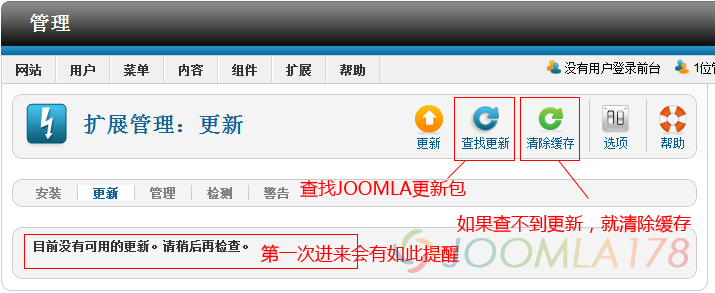

# Joomla 1.7升级至2.5，1.7模板可直接使用

对于Joomla! 1.7来说，它只不过是从Joomla! 1.5.x到Joomla! 2.5.x的一个过渡，所以Joomla! 1.7和Joomla! 2.5.x是同内核的产品，升级过程并不要借助第三方扩展！而且最重要的是：基于Joomla! 1.7制作的模板是可以直接安装在Joomla! 2.5.x，如果您使用了本站的Jk\_sunsane模板的话，可以放心的使用下列方法进行升级，本文也适用于Jk\_sunsane的升级。

第一步：Joomla! 1.7中有一项新的升级功能，进入后台“扩展”-“扩展管理”

进入扩展管理之后，请参考下图，第一次进来会提醒“目前没有可用的更新，请稍后再检查”，那么直接点击“查找更新”，如果查找不到更新，请点击“清除缓存”

第二步：在上面查到更新包后，勾选“Joomla”选项，再提交“更新”，如果J1.7的扩展按照Joomla! 2.5.x的规则做的话，也会提示扩展升级，如下图中的JCE

升级完成后，在Joomla! 信息处会看到当前版本为Joomla! 2.5.x，那么至此，我们的Joomla! 1.7已经升级到了Joomla! 2.5.x，建议中文语言包重新安装最新版

**出现的问题：**

1、在本地做升级测试的时候，可能因为下载问题、本地服务器权限问题无法升级的情况，这时候需要使用离线升级包，请移步：<http://joomlacode.org/gf/project/joomla/frs/> 选择[Joomla\_2.5.6-Stable-Update\_Package.zip](http://joomlacode.org/gf/download/frsrelease/17174/74755/Joomla_2.5.6-Stable-Update_Package.zip)，本文写作的时候Joomla! 2.5.6已更新，然后通过“扩展”-“扩展管理”安装该更新包

---

除特殊标明文章转自第三方网站，文章均由JOOMLASK.COM原创提供  
欢迎友情转载，请务必保留本文出处并引用本文链接： [Joomla 1.7升级至2.5，1.7模板可直接使用](http://www.joomla178.com/joomla-share/research-and-development/joomla17-update-to-joomla25.html)
