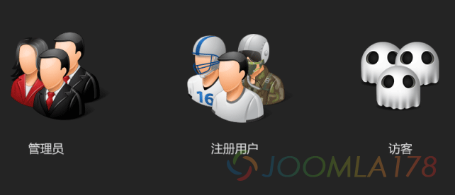
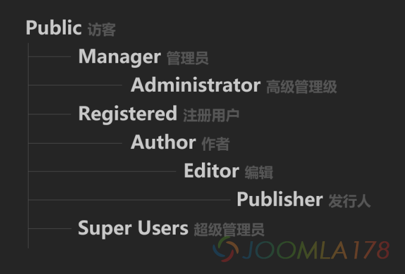
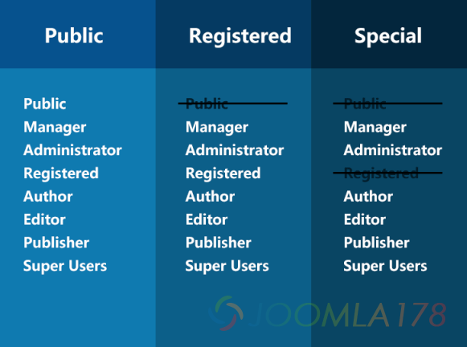

# Joomla 2.5 权限控制系统

本文转自<http://ninghao.net/blog/416>

如果你想控制用户能看到什么，能做什么，你需要使用Joomla的权限控制系统，英文名叫ACL，可被译成访问控制列表、权限控制系统或者是访问控制系统等等。

Joomla 2.5 的权限控制系统分成两个完全独立的系统，一个系统控制用户能看到什么内容，另一个系统控制用户能在网站中做什么。

Joomla 2.5 默认安装以后，已经有一套权限控制的规则，这套规则是模仿Joomla 1.5 时代的权限控制。你可以不使用这套规则，去重新创建。

下面我们用默认的权限控制规则来理解Joomla 2.5 的 ACL。

### 理解用户与用户组

用户就是使用你网站的人，用户组就是把这些人分组管理，你可以为每个用户组分配不同的权限。注意，默认安装了Joomla以后会默认创建一些用户组：

- Public
  - Manager
    - Administrator
  - Registered
    - Author
      - Editor
        - Publisher
  - Super Users

**注意：**

Joomla 把所有没登录的用户视为同在一个叫Public的用户组。在用户->用户管理->选项，可以重新指定访客用户组。

Joomla 会把在前台注册的会员默认放在Registered用户组里。同样可以在用户->用户管理->选项，重新指定注册会员默认的用户组。

如果在安装Joomla的时候选择安装示例数据，会多出两个用户组，Shop Suppliers，Customer Group。

### 控制用户能看到什么

控制哪些用户能看到哪些内容，方法就是创建访问级别，为访问级别指定用户组，为内容分配使用访问级别。在用户->访问级别，这里有三个默认的访问级别：

- Public
- Registered
- Special

**解释：**

Public访问级别里包含所有用户组，所以为网站内容指定Public访问级别，网站的所有用户都能看到这个内容。在Special访问级别里包含Manager，Administrator，Author，Editor，Publisher，Super Users，这些用户组。也就是，如果内容使用Special访问级别，只有当用户在Special访问级别所包含的用户组里，才能看到使用Special访问级别的内容。

**注意：**

管理后台使用的模块使用的都是Special访问级别。

### 控制用户能做什么

你想指定一些用户可以创建内容，一些用户能编辑内容，还有一些用户可以登录管理后台管理文章，这些都是对网站的操作。你为不同的用户组分配不同的操作权限。

Joomla的权限分为四个层级，分别是：

1. 全局设置
2. 组件
3. 分类
4. 文章

#### 底部层级权限可以继承或覆盖顶部层级的权限

全局设置是最顶部层级的权限，这些权限会被下面层级的权限所继承或覆盖，比如我们在全局设置里并没有为Registered指定创建内容的权限，如果你想让Registered可以在内容组件里创建内容，你可以在内容组件的选项里，为Registered用户组分配可以创建内容的权限。

#### 子用户组继承来自父用户组的权限

比如Editor是Author的子用户组，如果我们为Author分配了创建内容的权限，这个权限会被Editor所继承下去。Publisher是Editor的子用户组，所以Editor也会拥有创建内容的权限。

#### 在全局设置里可以为用户组分配的权限

- 登录前台：允许用户登录前台
- 登录后台：允许用户登录到网站的管理后台（<http://xxx/administrator>）
- 离线访问：当网站处于关闭状态时拥有这个权限的用户仍然可以访问前台页面
- 超级管理：超级管理员的权限，拥有这个权限，用户可以在网站中做任何的操作。并且其它的权限设置都不会起作用。
- 访问组件：打开组件管理界面的权限
- 创建任何内容：创建内容的权限
- 删除任何内容：删除内容的权限  
  编辑任何内容：编辑内容的权限
- 修改任何内容的状态：默认内容状态有发布，未发布，存档，回收站，拥有这个权限可以更改内容的不同的状态。
- 编辑自己的内容：只能编辑自己创建的内容

### 总结：

- 用户可以属于多个用户组，用户所属的所有用户组的权限都会传递给用户。
- 创建用户组可以使用层级关系，子用户组会继承父用户组的权限。
- 访问级别可以控制哪些用户都能看到什么样的内容。
- 对网站的操作权限分成四个层级来设置，分别是全局设置，组件，分类，还有文章。最底层的是文章层级的权限，为每一篇文章设置的权限可以覆盖来自所有顶部层级的权限。
- 子分类会继承父分类的权限。

### 相关课程

[Joomla 2.5 权限控制系统](http://ninghao.net/course/401 "Joomla权限控制课程")

---

除特殊标明文章转自第三方网站，文章均由JOOMLASK.COM原创提供  
欢迎友情转载，请务必保留本文出处并引用本文链接： [Joomla 2.5 权限控制系统](http://www.joomla178.com/joomla-share/research-and-development/joomla25-acl-system.html)
