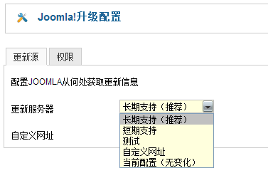

# Joomla! 3常见问题（下）

接上文[Joomla! 3常见问题（上）](joomla3-faq-1.md)

### 有必要从Joomla! 2.5升级到Joomla! 3吗?

In一般讲来，还是不要这么做 ，毕竟Joomla! 2.5要支持到2014年12月31日，当然你可以存一套副本升级至Joomla! 3做测试，最好的办法是等到Joomla! 3.5正式发布的时候再尝试升级，并保留2.5的备份。如果你实在要[Joomla! 3的新特性](joomla3-new-11-features.md "Joomla! 3中的11大新特色")，那就升吧！

### 当前Joomla! 2.5的站点在后台收到了Joomla! 3.x的升级通知，我可以按照这个通知升级？

除非是1000%地确认你要升级！顺便提醒一下，我们在[领略强大的Joomla!一键更新](joomla-one-click-updates.md) 文中详细说明了如何使用Joomla! 一键升级功能，当然这个一键升级更新功能有更强的自由选择性，一般官方是不会主动让你跨版本升级，除非。。。。进入 后台- 组件 - Joomla!升级 - 配置 - 更新服务器 -默认是选择长期支持，如果你选了“短期支持”那就可能会发出这个通知，比如现在是长期支持选项，那么你只会收到Joomla! 2.5的补丁升级通知。

要注意的是：如前文所述，升级之前确保扩展、模块有对应的升级版，否则在Joomla! 3.x中可能会不兼容。

### Joomla! 3.x是怎么规划版本的？

Joomla! 3.1已经在2013年4月15日发布（[Joomla! 3.1稳定版正式发布](http://www.Joomla178.com/news/joomla-news/532-joomla31-stable.html)），不用担心的是，从3.0升级到3.1也是一键升级（[领略强大的Joomla!一键更新](joomla-one-click-updates.md "领略强大的Joomla!一键更新")）。

### 我已经准备好就是要升级到Joomla! 3.x，怎么做呢？

- 第一呢，你得确保你所使用的服务器环境支持Joomla! 3.x与否，查看一下Joomla! 3.x的必备条件：[Joomla! 3如何选择主机服务商](http://www.Joomla178.com/joomla-share/research-and-development/546-joomla3-hosting.html)
  。
- 第二啊，确保你的所有扩展，比如模板能够兼容Joomla! 3.x。
- 第三啦，创建一个备份站点，测试是否能够正常升级。
- 第四喽，要是你百分百不相信自己，最好找个开发人员。
- 第五咯，还是备份，完整的备份原站点。

一旦你准备好了，按照上述办法中的进入 后台- 组件 - Joomla!升级 - 配置 - 更新服务器 -默认是选择长期支持，勾选“短期支持”然后在后台就能收到升级提醒 ，然后按照[领略强大的Joomla!一键更新](joomla-one-click-updates.md "领略强大的Joomla!一键更新")文中教学升级，成功后检测各项功能是否正常。

### 如果我是Joomla! 1.5的网站是不是已经不行了，是直接升级到2.5还是升级到3？

Joomla! 1.5确实是已经终止支持了，但是并不意味着你的网站要挂掉，然而Joomla!的二次开发者们已经不再做Joomla! 1.5的扩展了，所以还是建议升级到Joomla! 2.5先，这个建议参考[Joomla! 1.5模板升级至Joomla! 2.5 教程](../joomla-templates-tutorials/joomla15-template-upgrade-to-joomla25.md)、[Joomla!升级至Joomla! 2.5的常见错误解决办法](joomla-upgrade-joomla25-error-resolve.md)。

如果是从2.5升级到3的话，就非常简单了，届时官方会推出正式的更新办法，通常是一键升级，现在1.5升级有两个扩展 ，一个是jUpgrade，另一个是SP Upgrade

### 好吧，这是最后一个问题，我上哪找到Joomla! 3的最新资讯呢？

官方Joomla! 3站点： <http://www.joomla.org/3>.

Joomla!中文的Joomla! 3站点：暂无

---

除特殊标明文章转自第三方网站，文章均由JOOMLASK.COM原创提供  
欢迎友情转载，请务必保留本文出处并引用本文链接： [Joomla! 3常见问题（下）](http://www.joomla178.com/joomla-share/research-and-development/joomla3-faq-2.html)
