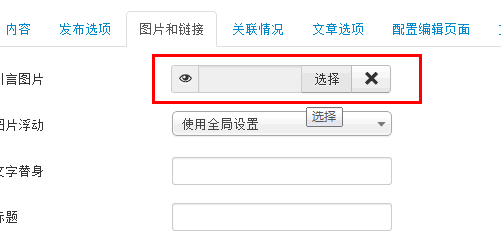
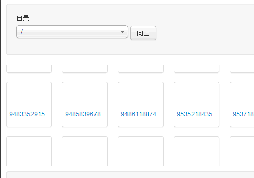
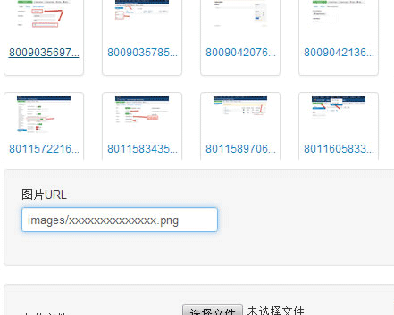
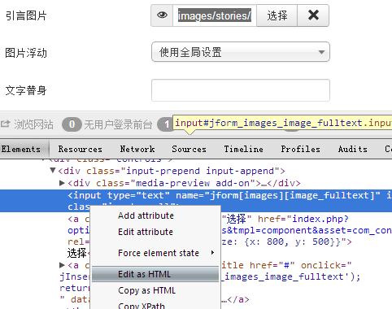
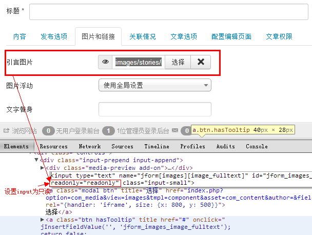

# Joomla! 3 文章配图小技巧

早在Joomla! 2.5的文章管理中就引入了“图片和链接”，其本意在解决文章起篇引言配图、全文配图独立呈现的功能，比如编辑并不希望这张图出现在引言代码或者全文代码中，避免文章模块读取到这张图，而现在的文章中的“图片和链接”就是有效了和文章内容分离，在使用这些功能的时候有些小技巧可以分享给大家

图片太多了，选择起来卡死！进入文章编辑状态后，点击“图片和链接”选项卡，可以看到引言图片选项中Joomla! 3中是不可以直接输入图片地址的，而是要点击“选择”。

当我们点击“选择”后弹出来的框，如果图片相对都较大，那么就如下图一样，截图的时候这些图片仍然没加载进来，实际上这些图片我们都挨个浏览了一次，太累赘。

在这个弹框中要经过漫长的等待后我们才能进行“上传”图片，否则会被默认上传到/images/目录下，所以小编想了一个招，一句话解释就是利用JCE编辑器先上传好图片，并把图片路径复制好，然后给填到引言图片处。

**第一种办法就是在弹出的弹框还没加载完图片的时候，就把图片路径填到“图片URL”处，如下图**

**第二种办法操作起来复杂，但是省去了打开弹框的功夫**

这时候要用到Chrome的开发者工具“F12”，使用Chrome右点引言图片不能点的地方，选择“审查元素”，轻松地选择到了input代码，再右点这段代码选择“Edit as HTML”，然后这段代码就变成可编辑状态了。

将代码中的参数readonly="readonly"删掉，再看input就能输入图片路径了，这个参数的功能就是让input显示为不可填写值的作用。

这样直接填入后，保存即可，可以鼠标移到“小眼睛”上预览图片。

---

除特殊标明文章转自第三方网站，文章均由JOOMLASK.COM原创提供  
欢迎友情转载，请务必保留本文出处并引用本文链接： [Joomla! 3 文章配图小技巧](http://www.joomla178.com/joomla-share/research-and-development/joomla3-insert-article-image.html)
