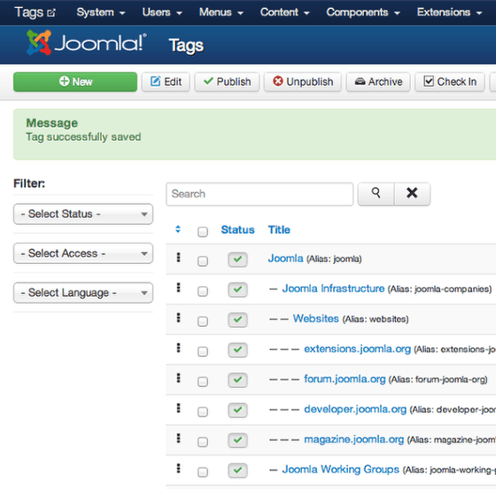

# Joomla! 3中的11大新特色

Multithumb found errors on this page:  
  
There was a problem loading image http://webtechpost.com/wp-content/uploads/2013/02/Image3.png  
There was a problem loading image http://community.joomla.org/images/stories/blogs/tags/tags\_component.png

我们在[Joomla!](http://www.Joomla178.com/) 3的最新新闻[Joomla! 3.1 Beta1发布，新引入了tag标签功能](http://www.joomla178.com/news/joomla-news/514-joomla31-beta1-new-features-about-tags.html)中添加了诸多新功能，相当于给下文做了补充，新的[Joomla!](http://www.Joomla178.com/) 3中将引入tag功能无疑是最大的亮点，解决了[Joomla!](http://www.Joomla178.com/) 一直以来自身不具有的相关文功能，在2.5中虽有相关文的模块，但文章中必须要有meta相关属性让其成了废弃模块，希望在[Joomla!](http://www.Joomla178.com/) 3中的tag功能真正用到实处。

本文针对当前[Joomla! 3.1 Beta1](http://www.joomla178.com/news/joomla-news/514-joomla31-beta1-new-features-about-tags.html)版本中的新特性做一下说明。

### 1.引入Bootstrap前端框架

[Joomla!](http://www.Joomla178.com/) 3引入了Bootstrap前端框架，一些基础CSS都默认集成在[Joomla!](http://www.Joomla178.com/) 3中，无疑极大的提升了用户体验

### 2.TAG时代的到来

我们知道，虽然在[Joomla!](http://www.Joomla178.com/) 2.5中新增了一个相关文章模块，但是它是以meta属性为依据，而大的网站如今已成型，再为过去的文章补充meta则是一件可怕的事，所以在[Joomla!](http://www.Joomla178.com/) 3中，TAG这个新特性就成了最大的亮点，详细请参考此文：[Joomla! 3新特性：Tags标签](joomla3-new-features-tags.md)

### 3. 新增前台模板Protostar，后台模板Isis，并升级了Beez2至Beez3

[Joomla!](http://www.Joomla178.com/) 自带模板是供二次开发者参考，Bootstrap前端框架的新增一款前台Protostart模板，后台模板Isis，并升级了Beez2至Beez3，这些模板都基于Bootstrap前端框架。

### 4.引入JUI

Joomla User Interface (JUI)向开发者提供了一套公用继承的工具集，从而给开发者节省了大量的重复开发时间，无需创建自用库。

### 5. Joomla开发平台版本

新的开发平台12.x相比11.x移除了大量弃用的类和方法，然而对于开发者来说，你的扩展可能要做一些微调来兼容[Joomla!](http://www.Joomla178.com/) 3

### 6. JQuery库正式加入

我们知道，Mootools的版本升级后会出现很多JS不兼容情况，而JQuery则不然，JQuery总会向下兼容，所以令人兴奋的是[Joomla!](http://www.Joomla178.com/) 3搭载的是JQuery库，Mootools 目前仍然在后台中正常使用（比如后台中的下拉菜单），但是这在将来将不会再做为主要JS库，JQuery必然取而代之。

### 7.引入了JFeed，而不再是简单的feed功能

Feed功能一直不为国内用户所用，其实目前年来，订阅内容将是未来抢夺用户手机、电脑桌面的又一利器，[Joomla!](http://www.Joomla178.com/) 3中将移除过去的自带简单feed功能，新引入了JFeed扩展功能。

### 8.自带TinyMCE升级至3.5.6版

也许你不再为找编辑器插件烦恼了，[Joomla!](http://www.Joomla178.com/) 3 中自带的TinyMCE将升级至3.5.6版本。

### 9.空文章可以无条件保存了

在[Joomla!](http://www.Joomla178.com/) 2.5中一篇只有标题、分类而没有填入内容的文章是不能保存的，这对编辑来说很头疼，所以在[Joomla!](http://www.Joomla178.com/) 3中改善了这个功能。

### 10.PostgreSQL支持

引入了更专业的数据库支持方式，让[Joomla!](http://www.Joomla178.com/) 能够在大型网站前表现不凡

### 11.多语言的完善

完善了多语言在[Joomla!](http://www.Joomla178.com/) 2.5中的欠缺，在新特性两篇文中有详细说明：[扩展的多语言及快捷筛选器功能](extension-of-items-associations-to-remaining-core-components.md)，[安装Joomla时同步在线安装语言包](installation-of-language-packs-when-installing-joomla.md)

---

除特殊标明文章转自第三方网站，文章均由JOOMLASK.COM原创提供  
欢迎友情转载，请务必保留本文出处并引用本文链接： [Joomla! 3中的11大新特色](http://www.joomla178.com/joomla-share/research-and-development/joomla3-new-11-features.html)
