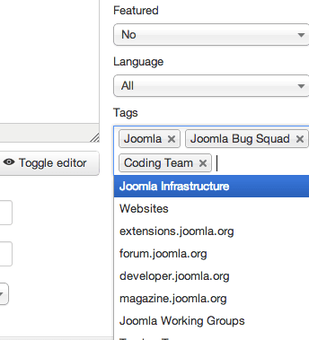
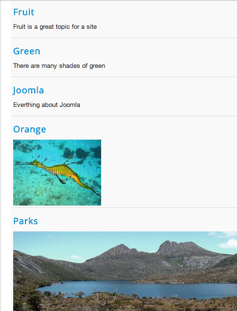

# Joomla! 3新特性：Tags标签

Multithumb found errors on this page:  
  
There was a problem loading image http://community.joomla.org/images/stories/blogs/tags/tags\_component.png  
There was a problem loading image http://community.joomla.org/images/stories/blogs/tags/tags\_in\_articles.png  
There was a problem loading image http://community.joomla.org/images/stories/blogs/tags/tags\_example\_in\_frontend.png

在Joomla! 3.1 Beta开发中，Joomla! 团队引入了一个新特性：Tags标签，这个功能会在后面的Joomla! 3.2中完善，Tags标签的好处不说大家自然知道，在Wordpress中比较常见，对于用户的粘性有很好的用处，在过去Joomla! 2.5中我们尝试使用meta属性来进行tags关联，实际效果并非那么好，所以将会以新的组件来实现。

我们希望本文能够引起开发者的兴趣，毕竟实际应用中并非我们希望的那样，所以如果你有兴趣，请来我们的开源项目组：[点击进入](https://github.com/elinw/joomla-cms/wiki/Using-tags-in-an-extension)

**一些关键特性的说明：**

- 首先这肯定是简单无疑的功能
- Tags标签会被集成在所有的核心组件中
- 扩展的开发人员可以轻松的添加Tags标签到他们的扩展中
- Tags标签是可以应用于不同的扩展中，比如跨表现类型。
- Tags标签是可以被嵌入，每个Tags标签有它的父级Tags标签和它的子级Tags标签
- 应该有几种布局表现，比如Tag模块
- Tags标签不会改变内容的发布状态或者ACL权限控制
- “多个类别Tags标签”，由ideas.joomla.org #7号提议。例如，你可以将相同的Tags标签分配给不同的内容类型 ,然后按Tags标签来创建博客布局

目前我们可以简单参考以下表现：

### Tags标签组件：

### 在文章管理中选择Tags标签

### 前台展示Tags标签

---

除特殊标明文章转自第三方网站，文章均由JOOMLASK.COM原创提供  
欢迎友情转载，请务必保留本文出处并引用本文链接： [Joomla! 3新特性：Tags标签](http://www.joomla178.com/joomla-share/research-and-development/joomla3-new-features-tags.html)
