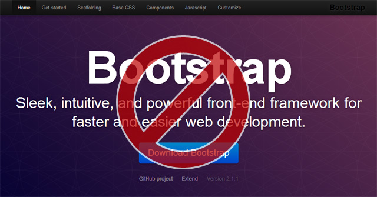
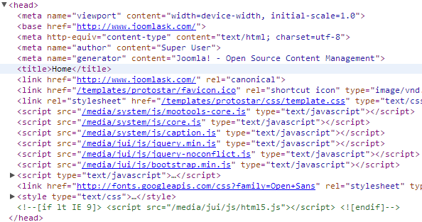
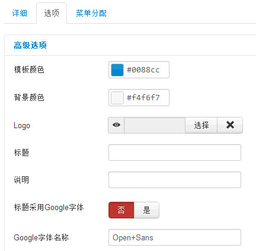

# Joomla! 3 删除原生JS框架



早先在Joomla! 1.5中曾经有这样的需求，如何移除Mootools这个JS框架，今天在Joomla! 3中你再也没有这样的需求了，因为Joomla! 3中引入了jQuery框架，但是你可能还有这样的需求：怎么移除原生的BootStrap框架呀？

在[Joomla! 3中的11大新特色](joomla3-new-11-features.md)一文中我们介绍过Joomla! 3引入了BootStrap这个当下最流行的前端框架，是的，它确实好用！不过这个框架目前在国内很难实用起来，因为它彻底不兼容IE6（至少我们网站也放弃IE6），而且IE7、IE8的支持并不太好，比如一些CSS3的东西都无法支持，而且在IE9中也有一些属性无法兼容，那么当前中国互联网的普通用户群仍然是以这些浏览器为主流，注定了我们这些二次开发者需要兼顾！

我们再用Chrome的开发者工具看一下Joomla! 3中多了些什么，mootools仍然是主要框架，在/media/jui/js中我们能看到jQuery框架，还有一个BootStrap框架，然后就是googleapis的字体框架，按照国内的开发者习惯以及一些政策来说，BootStrap和GoogleAPIS是我们要删掉的东西，BootStrap我们上面讲了，GoogleAPIS本来是个好东西，但是相信大家也了解，这个东西在国内会影响效率，搞不好网站半天打不开来。



重点来了，删除之前，我要和大家介绍一下这些东西是怎么来的，打开Joomla! 3中的默认模板文件：/templates/protostar/index.php，看到下面代码：

```
<jdoc:include type="head" /><!-- 所有的原生框架资源都是这一句 --><?php  // Use of Google Font  if ($this->params->get('googleFont'))  {?><!-- 判断是否要Google字体，如果后台设置为是，那么引用下述代码 -->    <link href='http://fonts.googleapis.com/css?family=<?php echo $this->params->get('googleFontName');?>' rel='stylesheet' type='text/css' />    <style type="text/css">      h1,h2,h3,h4,h5,h6,.site-title{        font-family: '<?php echo str_replace('+', ' ', $this->params->get('googleFontName'));?>', sans-serif;      }    </style><?php  }?>
```

我在行内给大家注释了，<jdoc:include type="head" />主要是Joomla! 引用所有原生框架资源的语句，下面的GoogleFont是可以通过后台关闭的，进入后台 - 扩展 - 模板管理 - 选择进入“protostar - Default”模板 - 点击“选项”选项卡 - 下方“标题采用Google字体”选择否就可以了！如果是外贸网站，可以保留此项



关键我们现在要把BootStrap给它弄掉，通常不建议修改Joomla! 核心代码，所以方法很简单，Joomla! 3引入了jQuery框架，我们就用jQuery的方法删掉BootStrap或者其它不想要的东西，方法如下：

打开Joomla! 3中的默认模板文件：/templates/protostar/index.php，找到代码“<jdoc:include type="head" />”，在其上方插入以下代码：

```
<script src="/media/jui/js/jquery.min.js" type="text/javascript"></script>  <script>  $(function(){$("script[src='/media/jui/js/bootstrap.min.js']").remove();});</script>  <jdoc:include type="head" />
```

我们在上文第2张图中知道这些JS文件的位置，由于我们使用的是jQuery语法，所以必须要先引用jQuery框架，按照第2张图标明的位置先引用，然后找到bootstrap.min.js的位置，使用jQuery的remove方法，删除此js即可。语句放在<jdoc:include type="head" />之前是按照先后加载的原则，如果放在其后面经过测试是无效的。

同样道理，其它的JS都可以JS的办法移除页面之中即可。

---

除特殊标明文章转自第三方网站，文章均由JOOMLASK.COM原创提供  
欢迎友情转载，请务必保留本文出处并引用本文链接： [Joomla! 3 删除原生JS框架](http://www.joomla178.com/joomla-share/research-and-development/joomla3-remove-self-js.html)
