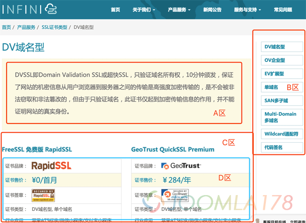
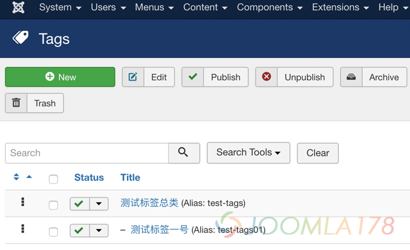
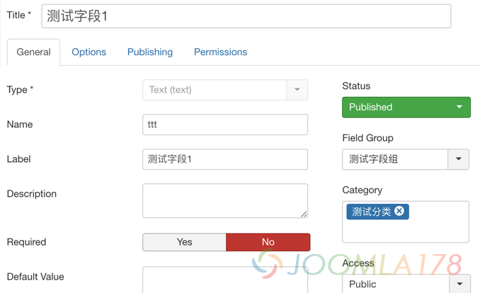
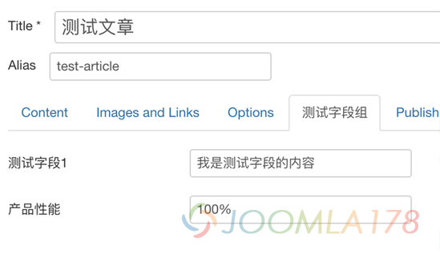
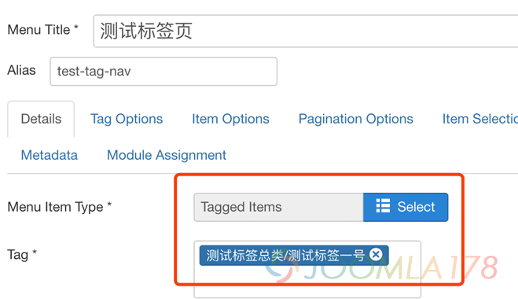
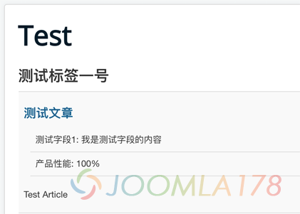

# Joomla! 3.8结合标签、自定义字段打造产品分类

我们知道Joomla! 3.7开始，最大的特征就是加入了自定义字段，[Joomla! 3.7.2加入自定义字段](http://www.joomla178.com/news/joomla-news/joomla37-add-custom-field.html)，但是在实际开发中，展示自定义字段也是可以文章分类来展示，我们称之为横向分类，但是如果有的业务场景是需要纵向分类，那就需要用到本文了，本文需要Joomla!的一些基础知识阅读！

这个时候，我们不仅要使用自定义字段(Fields)，而且还要使用标签(Tags)，以下简称Fields和Tags，如果你要准备做一个企业型站点的话，就可以充分使用Tags。先上截图和成品展示 ：

<https://www.infinisign.com/products/all-type/dv>



上图A区表示Tags名为DV域名型Tag的简介，B区为指定特定数量的所有Tag、C区是属于DV域名型Tag的文章，D区就是每个文章的Fields，这样的字段下分类，我们称之为纵向分类筛选，弥补文章分类的横向分类。

该站点在开发时，不仅要按产品品牌来分类，还需要按产品类型来分类，所以有类似横纵向场景的开发需求，可借助Tags来操作，正式开始：

### **第一部分：构建横向分类（文章类别 ）**

这个非常简单，在文章管理中添加分类，并在菜单中配置指向该分类的链接，比如开发站点中的RapidSSL分类，Demo：<https://www.infinisign.com/products/rapidssl>，这里不再详述，参考本站其它文章。

### 第二部分：构建纵向分类（Tags实现）

在“Components” - “Tags” 中添加类似下图中的标签，我们为产品设置一个总类叫“测试标签总类”，再设定一个标签“测试标签一号”，这个总类为了避免和其它常规标签混淆，专门给分类产品所用。



标签处理也非常简单，接下来我们继续给文章添加自定义字段

### 第三部分：添加自定义字段

**1、添加“Field Group”和“Fields”**

在“Content”-“Field Group”，添加一个名为“测试字段组”的“Field Group”。

再“Field Group”选项，选择“测试字段组”，“Category”选择“测试分类”。



**2、创建文章时选择自定义字段组**

“Content”-“Articles”，新增一篇文章，隶属于“测试分类”这个分类（务必选择分类，因为第1步中我们创建的Fields是专门给“测试分类”用的，否则不会出现“测试字段组”选项，如下图），Tags选择“测试标签总类/测试标签一号”。



在“测试字段组”选项卡中输入相关自定义字段内容。

**3、创建Tags菜单**

创建一个新的菜单“Tags” - “Toggled Items”，选择第1步创建的Tags名为“测试标签总类/测试标签一”，注意“Item Opitions”选项中务必要设置“Item Description”为“show”，因为自定义字段与此属性相关。



此时，我们访问**http://localhost:8801/index.php/test-tag-nav**却无法看到表现，这其实是一个BUG。

笔者发现位于/components/com\_tags/views/tag/tmpl/default\_items.php中可以看到有用于显内容插件的代码：`<?php echo $item->event->beforeDisplayContent; ?>`，而Fields是属于内容插件。

后在Joomla的[Github项目](https://github.com/joomla/joomla-cms)，中提及此BUG，BUG位于：**[#18992](https://github.com/joomla/joomla-cms/issues/18992)**，后开发者[laoneo](https://github.com/laoneo)修复此BUG并计划推送版本：[[com\_fields] Handle tag items properly#19006](https://github.com/joomla/joomla-cms/pull/19006) ，经过测试后，该推送版本的代码中存在异常导致无法显示，具体如下：

文件位于`/plugins/system/fields/fields.php`（注意：指的是该开发者计划合并的代码）

推送代码第423行：

```php
$item->id       = $item->content_id;
```

修改后代码：

```php
$item->id       = $item->content_item_id;
```

这是因为在数据库表(##\_contentitem\_tag\_map)中，关联内容的关键字段是`content_item_id`而不是`content_id`

保存后查看可以看到下图效果



到此完结，其中细节讨论不够详细，请见谅。

另外广告一下，INFINISIGN坐标位于上海，其代理来自国际CA直接代理 ，价格比较低，从本站跳转过去的用户可以获得￥1元购买PositiveSSL，前往务必注明来自Joomla178推荐才享有哦。

[查看PositiveSSL详情](https://www.infinisign.com/products/comodo/comodo-positivessl)

---

除特殊标明文章转自第三方网站，文章均由JOOMLASK.COM原创提供  
欢迎友情转载，请务必保留本文出处并引用本文链接： [Joomla! 3.8结合标签、自定义字段打造产品分类](http://www.joomla178.com/joomla-share/research-and-development/joomla38-build-product-pages.html)
