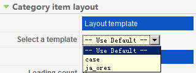
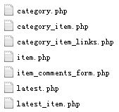
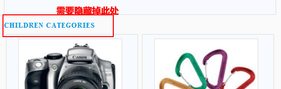
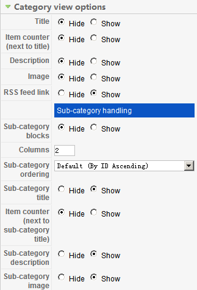

# K2 分类模板配置及分类参数设置详解及修改[一]

K2的优劣就不说了！说说这个分类设置的问题，再如何DIY这些分类设置。**（原创文章转载请标明出处，请引用本文地址）**

**开始之前我们要先做一些重要的事**：

1、给K2做一套适合你自己的模板，或者叫布局（layout template），前往K2的某个分类，打开分类后，右边Category item layout有个“设置一个模板（select a template）” 点开下拉菜单如下图！图中所示是我预设的两种样式。

2、前往文件夹\components\com\_k2\templates\中，不难发现有个名为“default”的文件夹！这就是第1条图中的Use Default配置，将此文件夹复制至 templates\ja\_ores\html\com\_k2\中 （注意，\ja\_ores\是本示例教程才有的文件路径，请将此名改为您所用的模板名，比如jk\_Joomla178），**这一步意味着，你的核心文件中的com\_k2\templates\将不再作用于K2的内容布局等，此时只有templates\ja\_ores\html\com\_k2\ 下面的文件起作用（如此做是为了以后K2升级之后，能继续保留这些修改配置，不可在\components\com\_k2\templates\中修改，一旦升级将有可能被覆盖）**

3、完成了第二步之后，此时就可以开始DIY了！前往templates\ja\_ores\html\com\_k2\，将default文件夹复制一份在同目录下，重命名为 yourtemplate，这时templates\ja\_ores\html\com\_k2\下就有了两个模板目录分别为default和yourtemplate，前往后台K2的分类设置中，刷新后台，便能见到图一中的情景

4、打开templates\ja\_ores\html\com\_k2\yourtemplate\ 发现有下图文件列表

5、开始DIY，举一个例子，K2分类默认配置的情况下，前台显示如下图，始终有个Children categories显示在

先不急着改程序，需要做的是检查后台是否有关闭此项显示的参数，前往后台K2分类设置处检查如下图（默认都是show,下图是本人所设置）

经过反复测试确认，后台中并无关于Children categories的显示与否！用firebug确定了代码大于在
处，打开文件**\templates\ja\_ores\html\com\_k2\yourtemplate\category.php  
CTRL+F找到代码：**
大约在77行左右，在此行代码的下面一行

<h3><?php echo JText::\_('Children categories'); ?></h3>  
只要将其注释掉即可（或者删除也行）

注释如：<?php /\*?><h3><?php echo JText::\_('Children categories'); ?></h3><?php \*/?>

**下一节将讲一下如何在后台配置中添加参数，以供用户选择是否显示Children categories**

[K2 分类模板配置及分类参数设置详解及修改[二]](k2-category-config-modyfy2.md)

---

除特殊标明文章转自第三方网站，文章均由JOOMLASK.COM原创提供  
欢迎友情转载，请务必保留本文出处并引用本文链接： [K2 分类模板配置及分类参数设置详解及修改[一]](http://www.joomla178.com/joomla-share/research-and-development/k2-category-config-modyfy.html)
