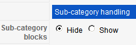
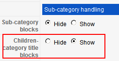

# K2 分类模板配置及分类参数设置详解及修改[二]

前面主要讲了[K2 分类模板配置及分类参数设置详解及修改[一]](k2-category-config-modyfy.md) 中关于怎么设置K2的模板，及举例使用模板的好处。下面我们来说一下如何在后台里面设置配置，决定Children categories是否显示，而不是前面说的直接删除。

如下图，我们举例准备把Children categories加在Sub-category blocks的上方，以方便管理和配置**（原创文章转载请标明出处，请引用本文地址）**



第一步，需要在控制台中加入配置选项，那么就先打开默认配置文件：

```
\administrator\components\com_k2\models\category.xml
```

找到Sub-category blocks相关的代码：

```
<param name="subCategories" type="radio" default="1" label="Sub-category blocks" description=""> <option value="0">Hide</option> <option value="1">Show</option> </param>
```

添加配置代码，并改为：

```
<param name="subCategories"  type="radio" default="1" label="Sub-category blocks" description=""> <option value="0">Hide</option> <option value="1">Show</option> </param> <param name="childrenCattitle" type="radio" default="1" label="Children-category title blocks" description=""> <option value="0">Hide</option> <option value="1">Show</option> </param>
```

上面定义了childrenCattitle，将作为后台所取得变量值，1为显示，0为隐藏，这时候保存category.xml文件，尝试刷新后台，便得到下图结果，多了一项刚才命名的配置Children-category title blocks



第二步，要把前面得到的childrenCattitle值，交给执行程序，去判断是1还是0。

再回到上一篇[K2 分类模板配置及分类参数设置详解及修改[一]](k2-category-config-modyfy.md)文章中说到显示Children categories是在  
**\templates\ja\_ores\html\com\_k2\yourtemplate\category.php**中的的代码：

```
<h3><?php echo JText::_('Children categories'); ?></h3>
```

将其改为：

```
<?php if($params->get('childrenCattitle') == 1) : ?><h3><?php echo JText::_('Children categories'); ?></h3><?php endif; ?>
```

原理很简单，通过$params取得xml配置中传入的childrenCattitle值 ，当其为1的时候才输出Children categories这几个字！这篇教程讲的比较简单，主要为了阐明K2的模板工作原理，以及DIY定制一些后台参数方法，本文可作参考！不过今天讲的涉及到改动K2的核心配置文件，还是要强调一下，注意备份

```
\administrator\components\com_k2\models\category.xml文件
```

```

```

---

除特殊标明文章转自第三方网站，文章均由JOOMLASK.COM原创提供  
欢迎友情转载，请务必保留本文出处并引用本文链接： [K2 分类模板配置及分类参数设置详解及修改[二]](http://www.joomla178.com/joomla-share/research-and-development/k2-category-config-modyfy2.html)
