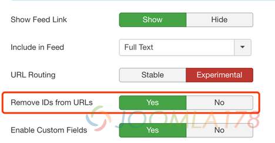

# Joomla! 3.8全新的URL路由-Rourte你了解多少

对于全新的Joomla! 3.8改进最大的应该就是自定义字段和全新的路由，对于路由，最简单的认识就是文章少了文章id，更得SEO搜索引擎优化，使用URL读起来更友好，搜索引擎更喜欢，下面我们来详细了解一下

### 代码层面

我们看到Route库在多个文件中有引入：

```php
/modules/mod_articles_latest/helper.php
/modules/mod_articles_news/helper.php
```

新版中的文件可以看到是这样

```php
JLoader::register('ContentHelperRoute', JPATH_SITE . '/components/com_content/helpers/route.php');
```

在老的版本中是这样的

```php
require_once JPATH_SITE . '/components/com_content/helpers/route.php';
```

使用该库没有什么变化，在`helper.php`中可以看到

```php
$item->link = JRoute::_(ContentHelperRoute::getArticleRoute($item->slug, $item->catid, $item->language));
```

### 功能设置

路由根据中文翻译解释是：改进型路由(Routing)启用高级功能，但可能会改变网站生成的网址(URLs)，保守型路由(routing)可以保证已经上线的网站完全兼容. 路由类型需要在每个组件中设置(Experimental Routing enables advanced features but may change your URLs. Stable routing ensures full compatibility for existing sites. This is configured per component.)。

言下之意是保守型路由()还是传统的文章带上文章ID，改进型路由()将移除URL中的文章ID，具体继续往下看

**进入“内容管理(Contens)” - “文章管理(Articles)”，点击“默认设置(Options)”，点击“整合选项(Integration)”，将“URL 路由(Routing)”先设置为“保守型(Stable)”**

我们再看文章URL地址如下：

```
未开启SEF的链接：
http://www.joomla178.com/index.php?option=com_content&view=article&id=668:latest-url-route-in-jooml38&catid=6&Itemid=169
开户SEF的链接：
http://www.joomla178.com/joomla-share/research-and-development/668-latest-url-route-in-jooml38.html
```

我们注意到，668就是我们这篇文章的ID，那么我们再开启“改进型路由”看看效果，重复上述配置步骤，按下图设定**将“URL 路由(Routing)”先设置为“改进型”，然后“从网址(URLs)中移除内容ID(Remove IDs from URLs)”，设为“是(Yes)”**



再看下前台URL如下：

```
未开启SEF的链接：
http://www.joomla178.com/index.php?option=com_content&view=article&id=668:latest-url-route-in-jooml38&catid=6&Itemid=169
开户SEF的链接：
http://www.joomla178.com/joomla-share/research-and-development/latest-url-route-in-jooml38.html
```

我们注意到，未开户SEF的链接没发生变化，开启SEF后的链接，文章的ID被移除掉了！

---

除特殊标明文章转自第三方网站，文章均由JOOMLASK.COM原创提供  
欢迎友情转载，请务必保留本文出处并引用本文链接： [Joomla! 3.8全新的URL路由-Rourte你了解多少](http://www.joomla178.com/joomla-share/research-and-development/latest-url-route-in-jooml38.html)
