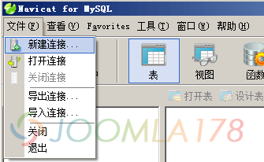
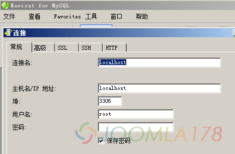
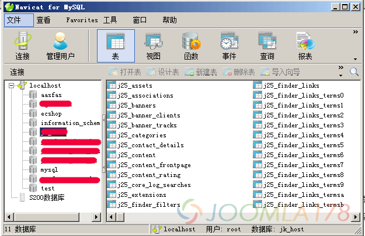
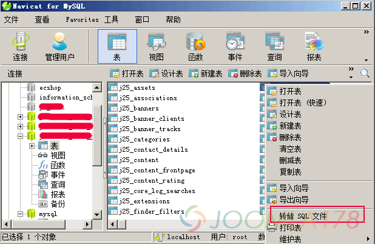
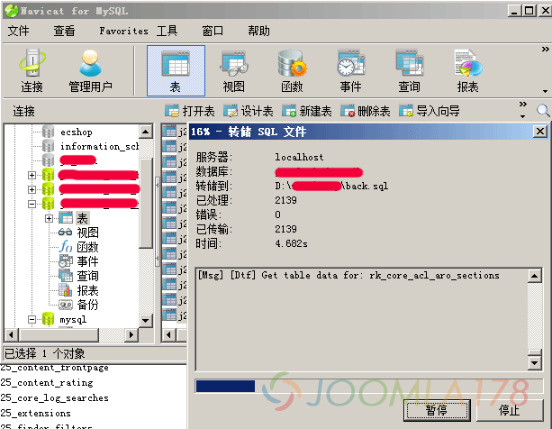
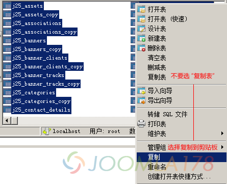
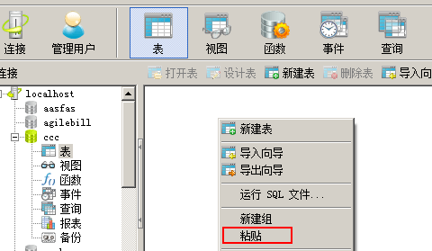
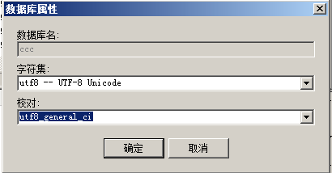

# MYSQL数据库迁移利器Navicat使用教程

Navicat是一个强大的MySQL数据库管理和开发工具。Navicat为专业开发者提供了一套强大的足够尖端的工具，但它对于新用户仍然是易于学习。Navicat使用了极好的图形用户界面（GUI），可以让你用一种安全和更为容易的方式快速和容易地创建、组织、存取和共享信息。基于Windows平台，为MySQL量身订作，提供类似于MsSQL的用管理界面工具。

**下面以本地服务器为示例打开Navicat，具体备份数据库如下：**

1、新建连接，本地MYSQL通常没有设置密码，点击确定即可（如果是远程服务器，需要服务器支持远程数据库连接，有的VPS比如kloxo、cpanel面板，需要设定本机IP为白名单才能连接。

2、连接成功随便点击其中一个数据库即可看到下图数据库对应的右侧数据表！

3、全选右侧的数据表，右击弹出菜单中选择“转储 SQL 文件”。

4、保证文件格式为.sql格式，弹出转储进度

5、最后进度框中会显示[Msg] [Dtf] Finished - Successfully 即表示转存完成！然后通过服务器/虚拟主机中的phpMyadmin功能就可以导入这个back.sql文件。

6、在上面第三步第1点中，再建立一个远程数据库的连接，请保证在服务器/虚拟主机控制面板中预先建立好一个数据库，这样再用Navicat连接远程数据库才能看到。

7、在上面第三步第3点中，全选本地数据库中的表，然后右击复制（注意不是复制表），或者ctrl+C复制所有表

8、在第1步中建立的远程数据库中打开建立好的空数据库，在右侧空白处，右击粘贴表，或者ctrl+V复制刚才在剪贴板中的表

9、非常重要的一点补充，所有的数据库操作后，请仔细检查数据库的编码、校对，右击数据库查看数据库属性，确认是utf8 -- UTF-8 Unicode编码，校对是utf8\_general\_ci

10、如果需要确认，就一路默认下来就可以了！

---

除特殊标明文章转自第三方网站，文章均由JOOMLASK.COM原创提供  
欢迎友情转载，请务必保留本文出处并引用本文链接： [MYSQL数据库迁移利器Navicat使用教程](http://www.joomla178.com/joomla-share/research-and-development/mysql-navicat-info.html)
