# Nginx中安装配置Let's Encrypt免费证书

我们知道SSL数字证书是给WEB访问及传输时加密认证功能，也就是我们通常以https://方式访问网站，简单讲就是更安全，而Let's Encrypt是一个公共的免费SSL项目，由Linux基金会托管，由Mozilla、思科、Akamai、IdenTrust和EFF等组织发起，目的就是向网站自动签发和管理免费证书，旨在让互联网由http到https加速普及。

本文主要介绍在Ubuntu+Nginx环境下如何安装Let's Encrypt免费证书。

### 一、依赖环境

笔者先前在CentOS 5.4下安装Let's Encrypt证书，遇到了难搞的问题，因为CentOS 5.4默认的Python版本没有达到Let's Encrypt的Python 2.6+版本要求，固尝试在CentOS 5.4中安装Python 2.7，后来深深的陷入了Python的升级中，最后解决不了无果，备份全站数据后直接将阿里云ECS变更为Ubuntu 14.04。

- Ubuntu 14.04 ~
- Git 1.9.1 ~
- Nginx 1.4.6 ^
- Python 2.6 ^
- 验证域名解析正常

### 二、下载及安装Git

大多用户应该并未安装Git，CentOS下安装Git稍显复杂，自行搜索相关资料，Ubuntu安装Git比较简单：

执行`git --version`如果没有显示`git`版本，则执行安装。

```
git --version
apt-get install git
```

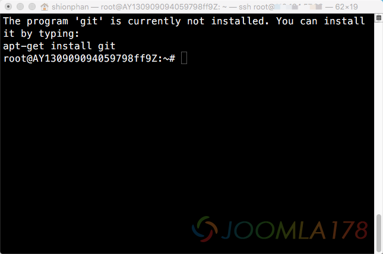

安装完成后，查看Git版本：

```
git --version
git version 1.9.1
```

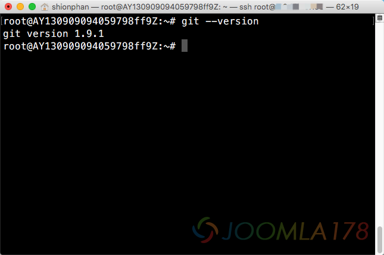

### 三、下载Let's Encrypt

安装Let's Encrypt比较简单，按照官方的说明即可：

```
git clone https://github.com/letsencrypt/letsencrypt
cd letsencrypt
```

这个下载过程会根据网络环境不等，持续不同的时间

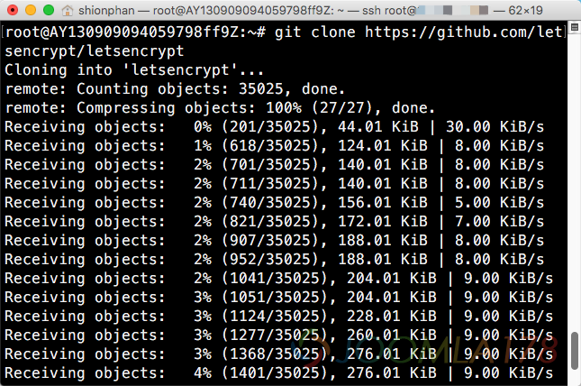

或者按ssh方式下载：

```
git clone 该 Email 地址已受到反垃圾邮件插件保护。要显示它需要在浏览器中启用 JavaScript。:certbot/certbot.git
```

关于ssh方式下载，需要了解关于ssh key知识，参考：[同一台电脑关于多个SSH KEY管理](one-pc-multi-ssh-key.md)

如果按照ssh的方式下载的话，并且无密码输入，就需要有一个github账号，并且如下图在个人中心添加一个ssh key对应自己服务器的公钥

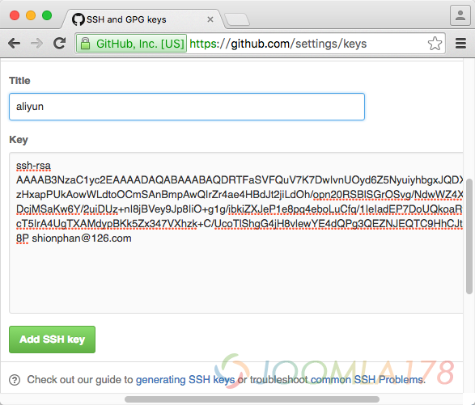

### 四、配置生成Let's Encrypt

大多数情况下，直接运行`letsencrypt-auto`或者`letsencrypt`命令后，Let's Encrypt客户端程序就会一步一步引导你获取并安装证书。

进入letsencrypt目录，并输入安装配置命令向letsencrypt服务器发起获取证书请求：

```
cd letsencrypt
./letsencrypt-auto certonly --server https://acme-v01.api.letsencrypt.org/directory --agree-dev-preview
```

在一大串环境配置的执行的等待中，看到如下图，可见Python的重要性。

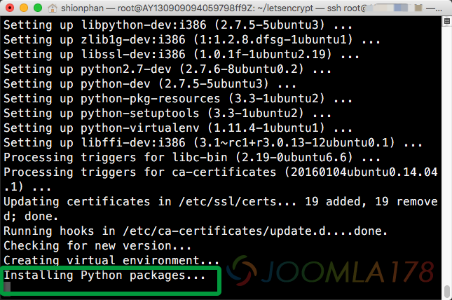

稍等片刻后出现下图界面，选择第2项（将证书存储在临时目录），并回车，或者点击“OK”

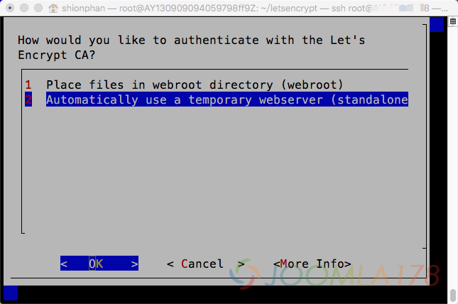

稍等片刻后，开始要求你输入域名信息，要知道Let's Encrypt是变相支持通配符证书，但是不是`*.joomla178.com`，而是要你整理好需要的子域名，比如我的网站1个顶级、2个子域名，满足需求了！

务必要注意的是，子域名一定要先解析设置好，否则会报错无法生成证书。

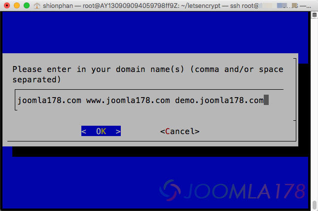

回车之后，迎来的一个报错是80端口被占用，意思是我的nginx已经使用了80端口，为了安装证书，只好先把nginx暂停一下：

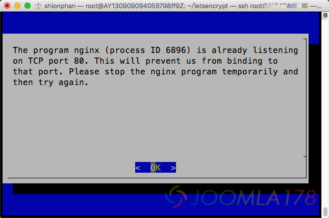

```
service nginx stop
```

停止nginx服务之后，从头再来一遍，直到出现下图表示成功：

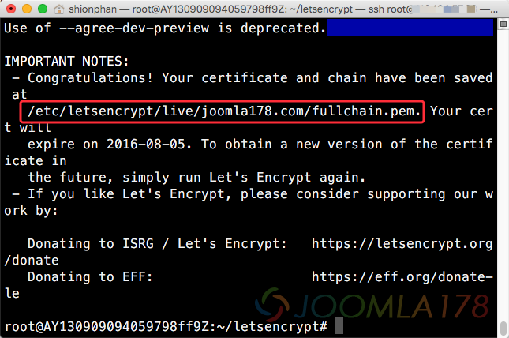

证书存在下述目录中：

```
/etc/letsencrypt/live/joomla178.com/
```

### 五、Let's Encrypt续期

要注意的是，该证书有效期是90天，如上图，2016-08-05就会过期，届时需要手动续签。

首先务必要暂停nginx服务，否则会提示上述的端口被占用的情况，然后仍然进入下载的letsencrypt目录，执行代码：

```
cd letsencrypt
./letsencrypt-auto certonly --renew-by-default --email 该 Email 地址已受到反垃圾邮件插件保护。要显示它需要在浏览器中启用 JavaScript。 -d joomla178.com -d www.joomla178.com -d demo.joomla178.com
```

这个过程可能会出现Let's Encrypt升级情况，毕竟Let's Encrypt也要有版本迭代嘛，耐心点。

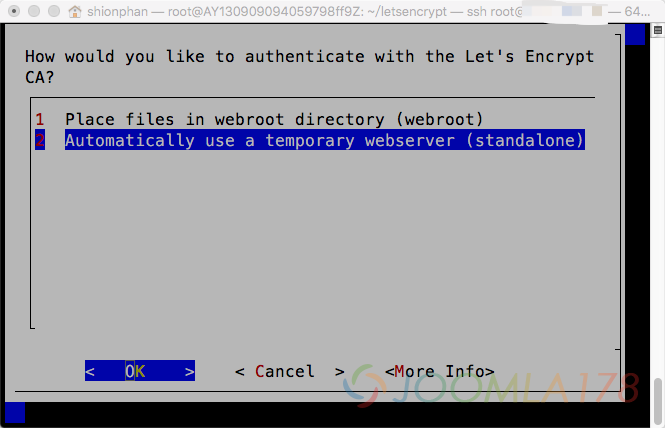

这时，仍然选择默认存储目录，选择2，然后回车或者点击“OK”，稍等片刻

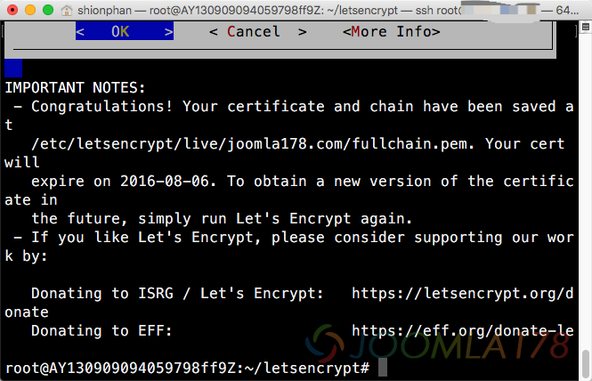

可以看到在稍等一会之后出现上图代码，注意新的过期时间是：2016-08-06，表明我们续期成功。

关于Linux的cron任务笔者并不擅长，所以不在本文阐述，别的网站教程也较多！

### 六、配置Nginx，并安装Let's Encrypt

对应域名的server{}中加入443端口以及证书配置路径

```
server {  
  listen 80;
  listen 443 ssl;
  server_name www.joomla178.com joomla178.com;
  index index.html index.htm index.php default.html default.htm default.php;
  root  /home/test/joomla178.com;

  ssl_certificate /etc/letsencrypt/live/joomla178.com/fullchain.pem;
  ssl_certificate_key /etc/letsencrypt/live/joomla178.com/privkey.pem;
  ....
}
```

```
server {  
  listen 80;
  listen 443 ssl;
  server_name demo.joomla178.com;
  index index.html index.htm index.php default.html default.htm default.php;
  root  /home/test/demo.joomla178.com;

  ssl_certificate /etc/letsencrypt/live/joomla178.com/fullchain.pem;
  ssl_certificate_key /etc/letsencrypt/live/joomla178.com/privkey.pem;
  ....
}
```

重启服务

```
service nginx restart
```

SSL操作需要消耗CPU资源，最消耗CPU资源的SSL操作是SSL握手，原理是在并发的连接或者后续的连接中重用SSL会话参数，这样可以避免SSL握手的操作。会话缓存用于保存SSL会话，这些缓存在工作进程间共享，可以使用ssl\_session\_cache指令进行配置。1M缓存可以存放大约4000个会话。默认的缓存超时是5分钟，可以使用ssl\_session\_timeout加大它。在上述代码中加入：

```
ssl_protocols TLSv1 TLSv1.1 TLSv1.2;
ssl_ciphers ECDHE-RSA-AES256-SHA384:AES256-SHA256:RC4:HIGH:!MD5:!aNULL:!eNULL:!NULL:!DH:!EDH:!AESGCM;
ssl_prefer_server_ciphers on;
ssl_session_cache shared:SSL:10m;
ssl_session_timeout 10m;
```

关于全局SSL还是局部SSL，可以参考[Nginx部署部分https与部分http](http://blog.csdn.net/na_tion/article/details/17334669)，笔者用的是Joomla!，想启用后台SSL加密，则在Joomla!中有具体的设置。

### 七、验证SSL

使用https://方式访问链接就可以看到地址栏有绿锁，有时候混合SSL时，这个绿锁则显示一些不安全，关于此类解决方案也是参考 [Nginx部署部分https与部分http](http://blog.csdn.net/na_tion/article/details/17334669)。

Chrome下显示证书详情：

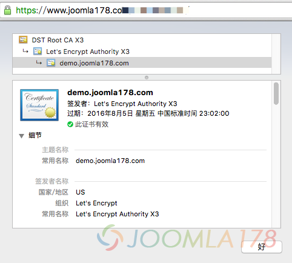

Safari显示证书详情：

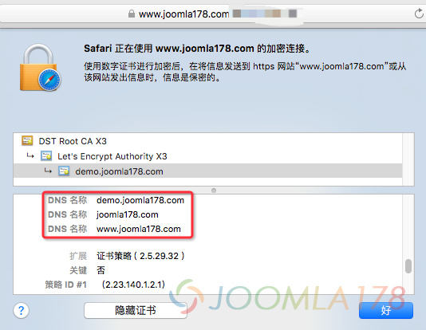

注意到的是，开篇安装的是多个子域名，所以显示demo.joomla178.com，再看细节是可以看到其它主域名和www域名。

验证SSL部署是否完整工具：[SSLZOO](https://sslzoo.com/sslcheck/?url=www.sslzoo.com)

---

除特殊标明文章转自第三方网站，文章均由JOOMLASK.COM原创提供  
欢迎友情转载，请务必保留本文出处并引用本文链接： [Nginx中安装配置Let's Encrypt免费证书](http://www.joomla178.com/joomla-share/research-and-development/nginx-installing-lets-encrypt-free-ssl.html)
