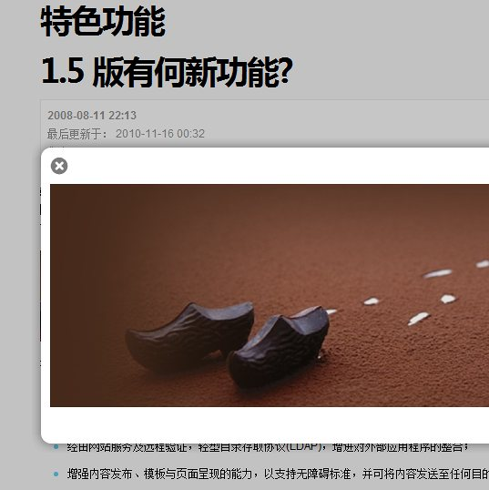

# Rockettheme的Rokbox插件的使用教程

[Rokbox插件](http://www.joomlaho.me/rokbox-37.html) 是Rockettheme的作品，是一个弹出式媒体插件，你可以用它在当前网页上直接弹出图片、网页、视频等媒体。点击下载[中文版 Rokbox](http://www.joomlaho.me/rokbox-37.html)，这里你可以 [查看演示](http://demo.rockettheme.com/extensions/rokbox)。下面来看一下Rokbox的使用方法。  
  
**安装并启用**：

**Rokbox**有两个文件，一个是 plg\_content\_rokbox\_1.6\_zh-CN.zip，另一个是 plg\_system\_rokbox\_2.4\_zh-CN.zip ，你需要用[Joomla](http://www.joomlaho.me/)分别安装这两个插件。然后登录管理后台-插件管理里找到 system-rokbox 与 content-rokbox并且启用它们。

**简单的使用**：

- {rokbox}图片路径{/rokbox}

**例**：选择一篇你想使用的文章，文章内容里插入下面的代码，joomla/img/slide.jpg是图片所在的地址。

- {rokbox}joomla/img/slide.jpg{/rokbox}

**解释**：上面的代码将会在文章中插入一张图片，图片的地址是joomla/img/slide.jpg， **Rokbox**会自动为你生成一个图片的缩略图，当点击这个缩略图时会有一个动画效果然后在当前页面显示原图。

**高级应用：**  
  
下面是[Rokbox](http://www.joomlaho.me/rokbox-37.html)的一些高级应用。  
**使用相册**：

{rokbox album=|album name|} 图片的地址{/rokbox}

解释：album name是相册名称，你在文章中插入的图片如何加上*album=|album name|*这个参数，那么这些图片将会被归类到一个相册中，当你点击其中任何一张图片时，图片的左右会出现小箭头，你可以用这个小箭头快速浏览所有相册里的图片。

**使用文本描述**：

{rokbox title=你的描述|| }图片的地址{/rokbox}

解释：点击图片时，图片的下面会显示一段描述，描述的文本用*title=你的描述*来定义。

**指定图片的缩略图**：

{rokbox thumb=|thumbnail\_link.jpg|}图片地址{/rokbox}

解释：*thumb=|thumbnail\_link.jpg|*这会给图片指定一个缩略图，默认情况下Rokbox会自定为你生成一个缩略图，如果你不想使用默认生成的缩略图，那么可以用这个参数手动指定一下。

**使用文本链接到图片**：

{rokbox text=|你的文本在这里|}图片的地址{/rokbox}

解释：点击文本显示图片，文本用*text=|你的文本在这里|*指定。

文章转自：<http://www.joomlaho.me/rokbox-tutorials-38.html>

---

除特殊标明文章转自第三方网站，文章均由JOOMLASK.COM原创提供  
欢迎友情转载，请务必保留本文出处并引用本文链接： [Rockettheme的Rokbox插件的使用教程](http://www.joomla178.com/joomla-share/research-and-development/rokbox-tutorials.html)
