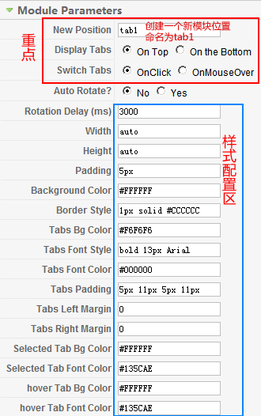
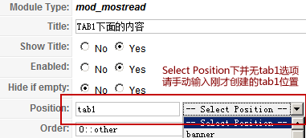

# 详解TAB模块Dinamods用法[初级配置篇]

Dinamods模块，应该算是比较好用的了，就连样式都可以在后台配置，将在稍后的第二节讲。**（原创文章转载请标明出处，请引用本文地址）**

在操作之前先说一下它的原理，dinamods本身只是一个创建模块位置的东西，通俗点就是你常见到的user1、user2、left、right这些模板设计的位置！Dinamods有TAB切换效果，所以它只是给你创建一个带有TAB效果的位置，这个位置具有了TAB的框架，步入正题。

1、先安装好mod\_dinamods-v2.0.1，在模块选项中创建mod\_dinamods，不难发现第一个参数就是New position，它告诉我们必须要先创建一个新位置，如下图，我们在这创建一个叫tab1的模板位置，其它暂且先默认，下面样式配置区在下节详述

2、创建好后保存，那么此时模板已经具有了一个叫tab1的模板位置，但是在模板位置选择列表中，它不会出现的！现在要做的就是选择需要在tab1里面显示的模块，它可以是文章列表模块、自定义html模块，只要是模块，它都可以放在tab1这个模板位置（有点像废话）

3、以mod\_mostread（最多阅读）模块为例，创建一个名为“TAB1下面的内容”的mostread模块，如下图！模块位置选项那里的Select Position点开后并无上述创建的tab1位置，这时候直接在模块位置那里输入tab1即可！

4、保存设置，刷新前台，即可看到效果！但是目前只是在tab1的位置创建了一个模块叫“TAB1下面的内容”，所以在前台看不到效果，那么还需要再创建一个名为“TAB1下面的另外一个内容”，位置也是选择tab1，因为他们两个都是要在tab1的位置显示！

**总结一下，这个模块灵活性很强，而且速度也很可观！并不像其它TAB类的JS，给网站增加诸多负担，推荐使用**

---

除特殊标明文章转自第三方网站，文章均由JOOMLASK.COM原创提供  
欢迎友情转载，请务必保留本文出处并引用本文链接： [详解TAB模块Dinamods用法[初级配置篇]](http://www.joomla178.com/joomla-share/research-and-development/sep-tab-module-dinamods-usage.html)
