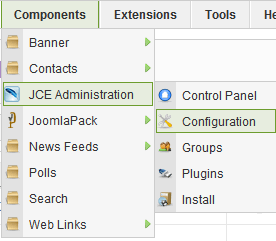
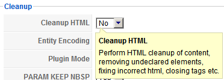
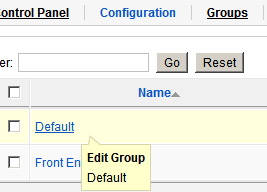
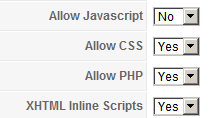

# 解决JCE编辑器代码自动清除办法

**JCE Editor**完美的用户使用编辑器权限控制，以及媒体媒体图片管理，被广泛应用！安全方便、美观大方、功能强大形容不足为过！**（原创文章转载请标明出处，请引用本文地址）**

不过在使用过程中，这款强大的JOOMLA编辑器，也会有些小毛病，对一些人来说，这个强大的功能就成了问题，例如有的编辑们通常是从Word里面复制文章过来，那么JCE就发挥了它的代码清除功能（Clean），但是对于技术开发人员来说，他们喜欢在文章中展示那些开发过程中的代码，这个代码清除功能无疑是个大麻烦。

举例来说HTML中的空格编码&nbsp、PHP中的<?php ?>，都可能是被清除的对象，不过JCE的开发者们早就想到了这些，在强大的后台中给了该给的配置功能

打开JCE编辑器全局配置：

即可看到全局配置中有“Cleanup HTML”，这一项对于展示代码的人来说，是需要关闭的，选择NO

光上述配置只能解决HTML类的清除问题，如果展示代码还需要展示CSS、PHP、XML这些的话，还需要前往下图中的“Groups”中配置，关于用户组控制权限将单独成文讲解。选择默认用户组（Default）

在默认用户组，选择选项卡中的**“Editor Parameters”**，之后往下拉即可看到**“Editor Options”**，具体如下图配置

Allow Javascript、Allow CSS、Allow PHP、XHTML lnline Scripts，按照展示需求依次设置，保存配置完成即可生效

---

除特殊标明文章转自第三方网站，文章均由JOOMLASK.COM原创提供  
欢迎友情转载，请务必保留本文出处并引用本文链接： [解决JCE编辑器代码自动清除办法](http://www.joomla178.com/joomla-share/research-and-development/solved-jce-editor-clean-code-auto.html)
