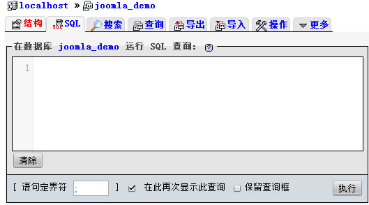
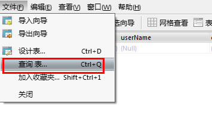
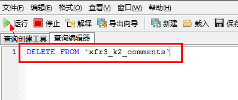

# 一条SQL语句删除Joomla!中千万条垃圾留言评论

朋友们在用Joomla!做站的时候需要增加留言功能，比如jComments评论扩展、K2自带的评论等等，站点上线后如果没有及时添加验证码，或者就算添加了验证码，也防不住垃圾评论，一旦不防，按照机器留言2秒/个的速度，每天会扫荡你的网站生成四五万条垃圾评论，手工在Joomla!后台删，那也要累死

**所以小编作为门外汉分享一下在MYSQL中的SQL语句批量删除办法**

我们要用到的工具自然是能处理MYSQL的工具，服务器一般配备了phpMyadmin，但是这里我们推荐桌面客户端的MYSQL工具：[Navicat Mysql版](http://www.Joomla178.com/cn/joomla-share/research-and-development/471-mysql-navicat-info.html)，使用方法请直接参考：[MYSQL数据库迁移利器Navicat使用教程](http://www.Joomla178.com/cn/joomla-share/research-and-development/471-mysql-navicat-info.html)，这里我们删除K2的垃圾评论为例，进入能执行sql命令的界面中（千盯万嘱，操作前记得备份，详情见：[Joomla!网站迁移备份全过程](http://www.Joomla178.com/cn/joomla-share/research-and-development/472-joomla-backup-all-step.html)）

**1、phpMyadmin中在左侧找到对应的数据库**joomla\_demo



点击"SQL"，然后输入下面命令并执行：

```

delete from `xfr3_k2_comments` //xfr3_是安装joomla时的表前缀
```

当然如果更细点的话，可以加一些条件句，找sql语句一类的教学就可以了

**2、Navicat中，也是找到并打开数据表joomla\_demo**



文件 - 查询表，弹出对话框中输入下面命令并执行：



同样可以加入一些其它的条件句，不过这里我们的目的就是为了删掉所有的垃圾评论，所以无条件的！

---

除特殊标明文章转自第三方网站，文章均由JOOMLASK.COM原创提供  
欢迎友情转载，请务必保留本文出处并引用本文链接： [一条SQL语句删除Joomla!中千万条垃圾留言评论](http://www.joomla178.com/joomla-share/research-and-development/sql-select-delete-trash-comments.html)
