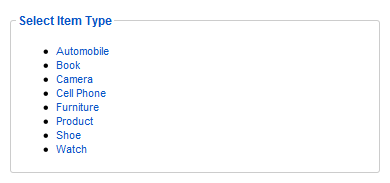
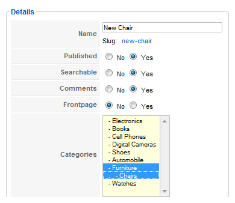
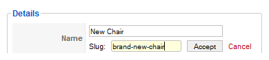
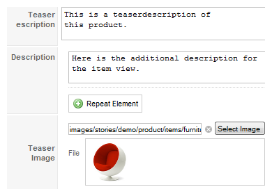
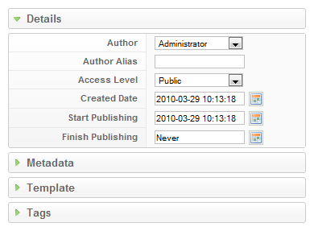
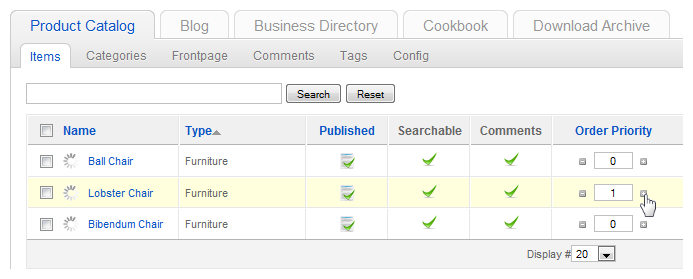

# ZOO实用手册 - 建立文章并管理

本系列教学转自[OKJoomla](http://www.okjoomla.com/companies/)，该系列教程由OKJoomla编写

在ZOO组件页面的的标签上选择我们的APP实例后，选择标签页上的第一个选项 ‘文章’（‘Item’）。这时我们可以看到我们的APP实例下已经创建的所有文章。

创建新的分类，选择屏幕右上角的‘新建’（‘New’）点击。我们可以选择创建的文章类型，如下图：

我们也可以创建自己需要的文章类型，见教程。

紧接着，我们会看到‘Detail’标签栏内的参数，该栏内我们可以设置文章的名字，是否发布，文章是否允许被搜索，是否允许客户留言，以及设置文章的所属分类。其中参数'Frontpage'的作用是,设置将文章在首页显示。你还可以使用ctrl+鼠标来设置文章归属于多个分类。

当我们为文章命名时，你会看到在它的下面有这样一个参数：‘slug’；该‘slug’参数随着标题被命名后，将会自动生成内容。slug（Alias）：标题别名，用于显示在浏览器的地址栏中，是文章的地址链接。

我们接着完善文章的信息。例如：引文描述（teaser description），description，为文章选择上传图片。您还可以通过‘重复’按钮（repeat）继续添加多个元件（elements）.

在屏幕区域的右侧，您还可以设置文章的一些附加信息，如作者信息，文章的访问权限，发布日期等。在其他的标签页，还可以设置metadata标签，以完善搜索引擎优化，在右侧的标签页中还为文章设置标签，这是一个很有用的功能，您可以点此查看如何添加标签的教程。

最后，一定记得编辑完文章后，点击‘保存’按钮。

## 二. 管理文章

 当您点击标签页中的‘Items’后，您会看到所有文章的列表。

利用参数‘Order Priority’可以为文章重新排序。可以点击‘+’或‘-’设置排序，或者直接输入排序的数字。

---

除特殊标明文章转自第三方网站，文章均由JOOMLASK.COM原创提供  
欢迎友情转载，请务必保留本文出处并引用本文链接： [ZOO实用手册 - 建立文章并管理](http://www.joomla178.com/joomla-share/zoo-handbook/zoo-handbook-creat-article.html)
