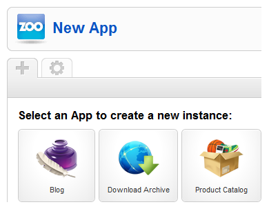

# ZOO实用手册 - 创建应用实例/app instance

Multithumb found errors on this page:  
  
There was a problem loading image http://www.okjoomla.com/images/tutoria1/02/3.png  
There was a problem loading image http://www.okjoomla.com/images/tutoria1/02/4.png  
There was a problem loading image http://www.okjoomla.com/images/tutoria1/02/05.png

本系列教学转自[OKJoomla](http://www.okjoomla.com/companies/)，该系列教程由OKJoomla编写

### 为什么创建APP实例（app instance）？

以Blog APP举例，如果要利用BLog APP 来创建自己的博客网站，就必须首先为Blog APP创建一个应用实例（app instance）。只有在创建好的实例下，才能继续创建博客分类，发布文章。换言之，这个应用实例（app instance）就是一个容器，只有在这个容器内我们才能继续操作。

### 选择APP

点击 Joomla后台 » Extensions » ZOO ,进入ZOO组件页面。如果您已经安装APP应用，那么点击Tab标签页上的“+”图标，并且选择APP，来创建APP实例（app instance）.

### 设置

首先，如图中显示，为实例命名。

### 参数

如下图的内容就是APP实例的全局参数；诸如：设置每页显示几篇文章（Items per Page），每页以几栏显示（Items Columns），文章的缩略图放置的位置（Teaser Media Alignment），等等。这些设置可以分别为首页，分类，以及文章页单独设置。

评论系统，我们另有独立的教程。

---

除特殊标明文章转自第三方网站，文章均由JOOMLASK.COM原创提供  
欢迎友情转载，请务必保留本文出处并引用本文链接： [ZOO实用手册 - 创建应用实例/app instance](http://www.joomla178.com/joomla-share/zoo-handbook/zoo-handbook-creat-case.html)
