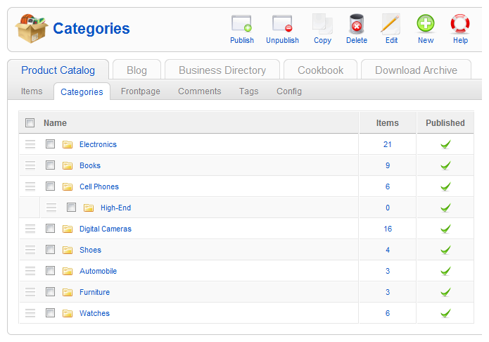

# ZOO实用手册 - 建立分类并管理

Multithumb found errors on this page:  
  
There was a problem loading image http://www.okjoomla.com/images/tutoria1/02/11.png  
There was a problem loading image http://www.okjoomla.com/images/tutoria1/02/12.png  
There was a problem loading image http://www.okjoomla.com/images/tutoria1/02/13.png  
There was a problem loading image http://www.okjoomla.com/images/tutoria1/02/14.png

本系列教学转自[OKJoomla](http://www.okjoomla.com/companies/)，该系列教程由OKJoomla编写

这一节我们与OKJoomla一起分享如何建立APP实例的分类，并设置分类的视图。

### 一. 创建新的分类

在ZOO组件页面的的标签上选择我们的APP实例后，选择标签页上的第二个选项 ‘分类’（‘Categories’）。这时我们可以看见我们的APP实例所拥有的所有分类。

创建新的分类，选择屏幕右上角的‘新建’（‘New’）点击。

如下图，我们可以为分类命名；设置分类的状态是否为发布；设置分类的归属；以及设置对分类的描述文字。

如下图，在“content”标签页中，

您可以设置简介图（teaser image）以及简介图描述文字。该简介图显示在它的上级分类的页面中。除了这个，还有分类图。

您可以设置分类图（image）以及分类图的描述文字，该分类图在显示该分类时显示。

如同我们设置首页时，可以为分类，文章设置在首页页面时所显示的名称；同样地，我们也可以为分类，文章设置在该分类页面上显示的名称。在‘ZOO使用手册 - 入门 5 - 管理首页’，教程中我们已经讲述过了如何选择图片。

之后的“Config”与“Template”两个标签页面上的设置可以替代App实例的全局设置。该设置，我们同样在‘ZOO使用手册 - 入门 5 - 管理首页’中已经讲述过，不再赘述。

设置结束后，点击“保存”（“Save”）按钮进行保存。

### 二. 排序分类

在ZOO组件页面的的标签上选择我们的APP实例后，选择标签页上的第二个选项 ‘分类’（‘Categories’）。这时我们可以我们的APP实例所拥有的所有分类。

如下图，拖拽分类的‘三’标记，可以为分类重新排序。

---

除特殊标明文章转自第三方网站，文章均由JOOMLASK.COM原创提供  
欢迎友情转载，请务必保留本文出处并引用本文链接： [ZOO实用手册 - 建立分类并管理](http://www.joomla178.com/joomla-share/zoo-handbook/zoo-handbook-creat-category.html)
