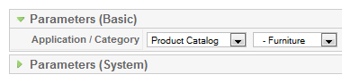
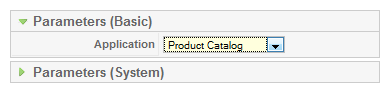
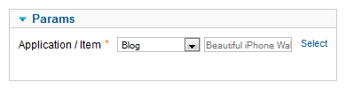
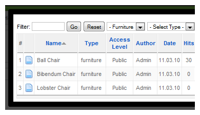
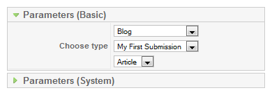
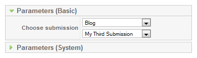

# ZOO实用手册 - 建立Joomla菜单链接

本系列教学转自[OKJoomla](http://www.okjoomla.com/companies/)，该系列教程由OKJoomla编写

这一节，OKJoomla与诸位分享如何为我们的ZOO的APP创建Joomla菜单，可以将我们的APP连接到网站的首页，分类，或文章页面。

点击  Joomla后台》菜单管理（menu manager）》新建菜单项（create a new menu item）

在组建列表中，我们选择ZOO并点击，我们会看到下列选项：Category（分类）, Frontpage（首页）, Item（文章）, Submission（前台提交文章） ，My Submissions（我提交的文章）。

如果您选择 Category（分类）选项之后，您就可以选择ZOO的APP实例，以及它的分类。

如果选择Frontpage（首页）的话，则只可以选择ZOO的APP实例，菜单会自动显示该APP实例的首页视图。

如果您选择Item（文章）的话，则可以在选择APP实例后，再选择一篇ZOO 文章。

点击select按钮后，会弹出一个弹窗，用以选择文章。

如果选择Submission（前台提交文章），您可以选择APP实例，以及前台提交 与 提交的类型。

如果您选择My Submissions（我提交的文章），您可以选择APP实例，以及前台提交。你还可以选择文章排序，以及我的提交屏幕。

点击屏幕右上角的‘Save’（保存）按钮，进行保存。

---

除特殊标明文章转自第三方网站，文章均由JOOMLASK.COM原创提供  
欢迎友情转载，请务必保留本文出处并引用本文链接： [ZOO实用手册 - 建立Joomla菜单链接](http://www.joomla178.com/joomla-share/zoo-handbook/zoo-handbook-creat-menu.html)
