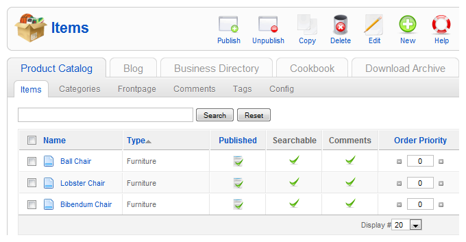
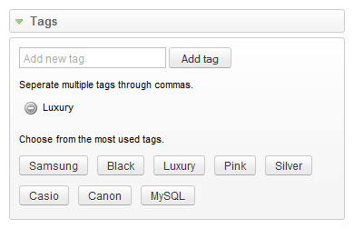
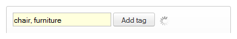
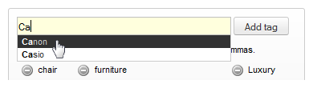
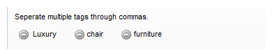
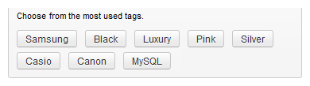
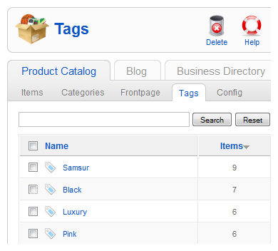
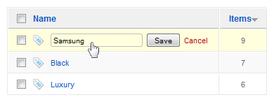

# ZOO实用手册 - 建立标签并管理

本系列教学转自[OKJoomla](http://www.okjoomla.com/companies/)，该系列教程由OKJoomla编写

这一节，OKJoomla与大家一起学习为文章设置标签，以及标签的管理。

### 一. 创建标签

在ZOO组件的标签上选择APP实例后，选择标签页栏的第一个选项 ‘文章’（‘Item’）。这时我们可以看到APP实例下已经创建的所有文章。

点击文章标题，进入文章编辑页面。

现在，我们点击屏幕右侧区域的‘Tags’标签栏，进入标签的设置。您可以在输入框中输入为文章设置的标签名称。

如下图，已经添加的标签显示在输入框下方，在标签左侧有一个删除符号，点击它可以删除已经添加的标签。在最下方，还会显示文章的常用标签，即：在所有文章中使用频率最多的8个标签。

要同时输入多个标签，只需要以逗号分隔，如下图：

在输入标签名称的过程中，系统会在下拉列表中为您自动匹配已经存在的标签，您可以通过点击下拉列表来直接添加。

输入完成后，会出现在标签列表中。

您可以直接在最常用的标签列表中为文章选择标签。

## 二. 管理标签

回到ZOO组件的首页面，选择APP实例后，选择标签页栏的第4个选项 ‘标签’（‘Tags’）。这时我们可以看到APP实例下已经创建的所有标签。

在该页面，可以选择标签，点击右上角的删除图标来删除标签。

如果要重命名标签，只需要直接点击标签的名称，修改名称即可：

---

除特殊标明文章转自第三方网站，文章均由JOOMLASK.COM原创提供  
欢迎友情转载，请务必保留本文出处并引用本文链接： [ZOO实用手册 - 建立标签并管理](http://www.joomla178.com/joomla-share/zoo-handbook/zoo-handbook-creat-tag.html)
